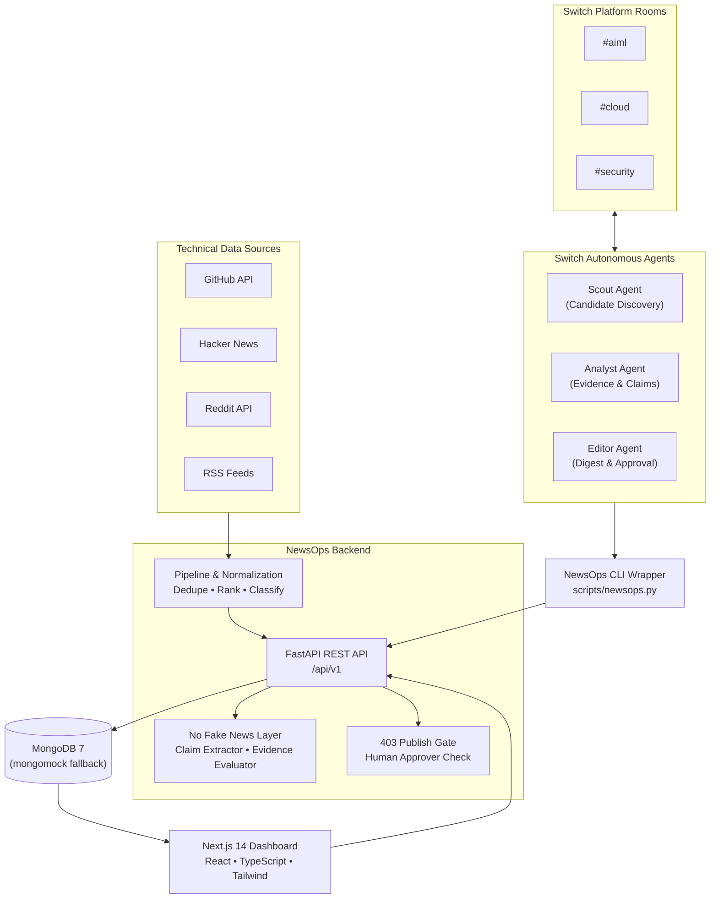

# NewsOps — Developer Intelligence Engine

NewsOps is a developer-intelligence and claim-verification platform built for technical ecosystems across GitHub, Hacker News, Reddit, and RSS feeds.

It normalizes and deduplicates articles, extracts verbatim install commands, isolates atomic factual claims, attaches strict trust badges, and coordinates human-in-the-loop digests delivered in partnership with the **Switch Agent Platform**.

---

## Architecture



---

## How Switch is Used

NewsOps coordinates with three autonomous agents running in Switch Console rooms (`#aiml`, `#cloud`, `#security`):
1. **Scout (`agents/SCOUT.md`)**: Periodically inspects candidates (`python scripts/newsops.py candidates <room> --limit 8`), posts brief highlights in the room, and asks Analyst to review.
2. **Analyst (`agents/ANALYST.md`)**: Fetches evidence and install commands (`python scripts/newsops.py evidence <id>`), verifies claims, and submits analysis to the backend. If confidence is below 0.70 or contradictions are detected, flags for human review.
3. **Editor (`agents/EDITOR.md`)**: Curates approved stories into digests (`python scripts/newsops.py digest <room>`) and prompts authorized room approvers. Once approved, publishes via `python scripts/newsops.py publish <id>`.

> **TODO(SWITCH-OWNER)**:
> The Switch room configuration, template import, and platform webhook endpoints are managed in Switch Console by the project owner (Nikhila). System prompts in `agents/SCOUT.md`, `agents/ANALYST.md`, and `agents/EDITOR.md` are copied into the Switch platform agent templates.

---

## Quick Start

### Option 1: Docker Compose (All-in-one)
```bash
docker compose up --build
```
- **Web Dashboard**: `http://localhost:3000`
- **FastAPI API**: `http://localhost:8000`
- **Interactive Swagger Docs**: `http://localhost:8000/docs`

### Option 2: Local Development Mode (No Docker required)
```bash
# 1. Install backend packages
pip install -r requirements.txt

# 2. Run backend (uses automatic in-memory MongoDB fallback if local Mongo is absent)
python run_backend.py

# 3. In another terminal, install and run frontend
cd web
npm ci --legacy-peer-deps
npm run dev
```

### Option 3: Windows Launcher
Run `launch.bat` and select `[1]` for Docker Compose, `[2]` for Local Dev, or `[3]` for Pytest.

---

## Verification & Smoke Test

To verify end-to-end functionality against a running instance:
```bash
python scripts/smoke.py
```
This tests the full agent workflow:
1. `GET /agent/candidates` (Scout)
2. `GET /agent/stories/{id}/evidence` (Analyst)
3. `POST /agent/stories/{id}/analysis` (Analyst submission)
4. `POST /agent/digests` (Editor compilation)
5. `POST /digests/{id}/publish` (Verified 403 Forbidden on unapproved draft)
6. `POST /agent/digests/{id}/decision` (Approval by authorized room reviewer)
7. `POST /digests/{id}/publish` (Publish succeeds once approved)

Run unit and integration test suites:
```bash
# Backend pytest suite (78 tests)
python -m pytest tests -v

# Frontend type check and vitest suite
cd web
npm run type-check
npm test
```

---

## Environment Variables

| Variable | Default | Purpose |
| :--- | :--- | :--- |
| `NEWSOPS_OFFLINE` | `True` | Loads rich seeded stories across #aiml, #cloud, #security without API keys |
| `AGENT_API_TOKEN` | `dev-agent-secret-token-change-me` | Shared bearer token for `/agent/*` endpoints |
| `NEWSOPS_API` | `http://localhost:8000/api/v1` | NewsOps API base URL used by CLI wrapper |
| `MONGODB_URI` | `mongodb://localhost:27017` | MongoDB connection string (falls back to mongomock-motor) |
| `MONGODB_DB` | `newsops` | Database name |
| `CORS_ORIGINS` | `http://localhost:3000,http://127.0.0.1:3000` | Allowed origins for cross-origin requests |
| `NEXT_PUBLIC_API_BASE`| `http://localhost:8000/api/v1` | Frontend API connection address |
| `NEXT_PUBLIC_MOCK` | `0` | Set `1` to run frontend against MSW mocks |
| `NEXT_PUBLIC_MATTERMOST_URL`| `""` | Optional link to Mattermost / Switch chat channels |

---

## Data Sources & Operational Limits

- **GitHub REST API**: Ingests release notes, tags, and commits. Extracts verbatim README install commands.
- **Hacker News (Algolia Search API)**: Used for discovery and community discussion signals only. Zero credentials required.
- **Reddit OAuth**: Used for developer sentiment and early discovery signals.
- **OSV.dev / RSS Feeds**: Authoritative security advisories and CVE reports.
- **Rate Limits & Budgets**: Capped at 60 articles per ingestion run (`TASK_MAX_ARTICLES=60`). Agent runs capped at 8 candidates per cycle.

---

## Benchmark Evaluation

The evaluation suite (`eval/dataset.py`) contains a **20-sample hand-labelled test set** of real-world developer claims across version updates, security advisories, and benchmark statements. It measures precision and contradiction detection under controlled inputs; it does not claim generalized natural language accuracy across arbitrary web text.

---

## Honest Limitations

1. **Local Agent Dispatch**: Switch agents run via the local CLI wrapper on a workstation; large-scale distributed agent swarms across cloud clusters require Switch Platform enterprise hosting.
2. **Supported Platforms**: GitHub, Hacker News, Reddit, and RSS/Atom feeds are supported. Proprietary platforms (such as X/Twitter and Instagram) are unsupported.
3. **Trust Badges**: Badges (`primary`, `vendor_reported`, `community_signal`) classify source provenance; they are not philosophical truth guarantees. `community_signal` (Reddit/HN) is discovery-only and can never alone support a factual claim.
4. **Verbatim Install Commands**: Commands are deterministically extracted substrings of official README files and are never auto-executed by NewsOps.

---

## License

MIT License (see [LICENSE](LICENSE)).
